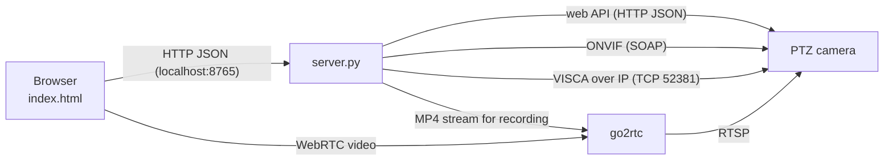

# PTZ Desk

A browser-based control desk for network PTZ cameras: live video, smooth joystick moves, straight
preset moves, focus pulling, exposure control, recording and post stabilization – served by a
small Python server on your own computer, no cloud and no installation beyond Python and go2rtc.

It was built to film stage performances from the back of a room with a PoE PTZ camera, where
every pan has to look calm on the recording and every control has to be within reach without
scrolling.

> Developed and tested with a **TONGVEO 4K AI PTZ** (20× optical zoom, HDMI/USB 3/LAN/PoE).
> Many OEM PTZ cameras share its web API, ONVIF and VISCA-over-IP implementation, so others may
> work as well – the diagnostics in the settings dialog show quickly what your camera supports.

---

## Features

### Live view – everything on one screen
The video is shown as large as the window allows, and the control column next to it is always
exactly as tall as the video – the joystick grows and shrinks with the available space.

- **Live video** in the browser with low latency (camera RTSP → [go2rtc](https://github.com/AlexxIT/go2rtc) → WebRTC).
- **Joystick plus zoom and focus rockers** that spring back when released. Pan and tilt run
  together, along jerk-limited **S-curves** for acceleration and braking.
- **Direction-true control:** the joystick compensates for pan being faster than tilt, and the
  engine picks the pair of camera speed levels that best matches both direction and speed.
- **Mouse wheel** tilts (vertical) and pans (horizontal, or <kbd>Shift</kbd> + wheel) and zooms
  (<kbd>Ctrl</kbd> + wheel) in short bursts. **Holding the wheel button** turns the mouse into a joystick; a yellow pie slice shows
  the range in which the camera's direction stays the same.
- **Double-click aiming:** double-click a spot in the image and the camera brings it to the
  centre on a smooth straight move. The page finds the spot again afterwards, corrects any
  remainder once and learns the image scale per zoom position.
- **Keyboard:** arrow keys (combinable), <kbd>+</kbd>/<kbd>−</kbd> zoom, <kbd>N</kbd>/<kbd>F</kbd>
  focus, <kbd>L</kbd> loupe, <kbd>H</kbd> home, <kbd>1</kbd>–<kbd>9</kbd> presets.
- **Presets 1–9 with names.** Double-click the small save button next to a preset to store the
  current view there on the fly; the pencil switches to editing names. Recalled presets move on a **straight, smooth line** – the server
  drives the move over VISCA and corrects it ten times a second, because the camera's own
  preset recall finishes tilt early and draws a bent path. Zoom and locked focus are restored too.
- **Focus:** autofocus, lock, one-push focus (autofocus briefly, then lock), a focus rocker with
  variable speed, a 3× **loupe** for the image centre and a **sharpness meter** with peak hold.
- **Exposure** (VISCA): auto, iris priority and manual; open the iris fully with one click;
  exposure compensation, shutter and gain. An **overexposure warning** appears on the image when
  parts of it clip to white – useful with spotlights on a dark stage.
- **Recording** on the server in original quality (no re-encoding), split into files of a set
  length; **stills**, composition **guides** (crosshair, thirds), **180° rotation**, full screen.

### Settings dialog
Everything else lives in a settings dialog (gear button, top right) with tabs on the left:

| Tab | Content |
|---|---|
| Camera | connection status, live stream choice, reconnect, camera auto-tracking on/off |
| Audio | audio source: the camera stream (line input) or an audio input of this computer, e.g. a USB audio interface; optional monitoring in the browser |
| Controls | key speeds, zoom-key behaviour, wheel sensitivity, axis inversion, shortcut list |
| Motion | motion curves editor with live preview: acceleration, braking, S-shape and top speed per axis |
| Presets | straight or camera-driven recall, top speed, minimum duration, one-click **speed calibration** of all 24 levels |
| Recordings | list of recordings and post stabilization (below) |
| Calibration | record a motion test, VISCA check |
| Diagnostics | status table, copyable report, log |

### Recordings
- Lists the recordings with length, size and audio.
- **Post stabilization:** measures the camera motion frame by frame, smooths the path and shifts a
  slightly cropped image along. The small jolts at the camera's speed levels and hard starts turn
  into smooth transitions while intended pans stay. Three strengths; the original stays untouched.

---

## Requirements

| | |
|---|---|
| Operating system | Windows 10/11 (the server also runs on Linux/macOS; a few conveniences such as opening folders are Windows-only) |
| Python | 3.8 or newer – standard library only |
| Video | [go2rtc](https://github.com/AlexxIT/go2rtc/releases) binary next to `server.py` |
| Browser | a current Chrome, Edge or Firefox |
| Optional | `ffmpeg`, `numpy` and `opencv-python-headless` for stabilization (installable from the Recordings view) |

The camera must be reachable on your network and should have **ONVIF** and **VISCA over IP**
enabled, its **RTSP** streams switched on and the video codec set to **H.264**.

## Quick start (Windows)

1. **Install Python** (if needed): `winget install Python.Python.3.13`
2. **Get go2rtc:** download `go2rtc_win64.zip` from the
   [releases page](https://github.com/AlexxIT/go2rtc/releases) and put `go2rtc.exe` next to `server.py`.
3. **Configure:** copy `config.example.ini` to `config.ini` and fill in the camera IP, user,
   password and the two RTSP addresses (from the camera's web interface, *Network → RTSP*).
4. **Start:** double-click `start.bat`. The control page opens at <http://localhost:8765>.
   On first start Windows Firewall asks about go2rtc – allow access for private networks.
5. **Optional, for stabilization:** `winget install Gyan.FFmpeg`, then click
   *Install numpy and OpenCV* in the Recordings view.

To stop, press <kbd>Ctrl</kbd>+<kbd>C</kbd> in the console window or close it; the camera is
stopped and go2rtc is shut down with it.

On Linux/macOS: put the `go2rtc` binary next to `server.py` and run `python3 server.py`.

## Configuration

All settings live in `config.ini` (see `config.example.ini`); restart the server after changes.

| Section | Key | Meaning |
|---|---|---|
| `[camera]` | `ip` | camera address |
| | `onvif_port`, `web_port` | ONVIF port (often 8080) and web interface port (80) |
| | `control` | `auto` (camera web API, falling back to ONVIF), `web` or `onvif` |
| | `user`, `password` | login of the camera web interface |
| | `rtsp_main`, `rtsp_sub` | RTSP addresses of the main and sub stream |
| `[server]` | `port` | port of the control page (8765) |
| | `local_only` | `yes`: page only reachable on this computer; `no`: also from other devices on your network |
| | `open_browser` | open the page automatically on start |
| `[recording]` | `folder` | target folder (empty: *Videos/PTZ Desk* in your user folder) |
| | `split_minutes` | start a new file every N minutes (0 = one file) |
| | `stream` | `main` (full resolution) or `sub` |

Everything you set in the page (curves, preset names, learned targets, calibrated speeds) is
stored next to the server in small JSON files and survives restarts:

| File | Content |
|---|---|
| `curves.json` | motion curves and measured image speeds per level |
| `presets.json` | preset names and their VISCA targets (pan, tilt, zoom, focus) |
| `glide.json` | settings for straight preset moves |
| `visca_speeds.json` | calibrated speed per VISCA level and axis |
| `click_scale.json` | learned image scale per zoom position for double-click aiming |
| `audio.json` | chosen audio source |

Browser-side preferences (stream, guides, rotation, key and wheel settings) are kept in the
browser's local storage.

## Tips for filming a stage performance

1. In **Settings → Presets**, run **Calibrate speeds** once (about two minutes).
2. Set up the presets you need (stage, lectern, aisles …): frame the shot, double-click the save
   button of a preset, and give it a name with the pencil.
3. Before the show: point at the stage, press **One-push** focus – focus is then locked and will
   not hunt when lights change.
4. Exposure: choose **Iris**, press **Open**, then lower **Exp. comp.** until the overexposure
   warning disappears from the faces in the spotlight. With LED lighting that flickers, switch
   to **Manual** and adjust the shutter.
5. During the show: recall presets with <kbd>1</kbd>–<kbd>9</kbd>, follow people with the wheel
   button joystick or a double-click, and stabilize the recording afterwards.

## How it works

- **`server.py`** – HTTP server and glue: camera web API, ONVIF and VISCA clients, go2rtc
  supervision, recording, presets, focus, exposure, calibrations, stabilization jobs.
- **`motion.py`** – the motion engine: jerk-limited S-curves at 50 Hz, a dead man's switch,
  and mapping onto the camera's 24 speed levels.
- **`glide.py`** – straight preset moves (closed-loop over VISCA with look-ahead) and the
  image-scale model for double-click aiming.
- **`visca.py`** – minimal VISCA-over-IP client (TCP 52381, UDP 52381, UDP 1259).
- **`stabilize.py`** – post stabilization (phase correlation, Gaussian path smoothing, crop).
  Also usable on its own: `python stabilize.py recording.mp4 [light|medium|strong]`.
- **`index.html`** – the whole control page; no build step, no dependencies.

### Security

The server binds to `127.0.0.1` unless `local_only = no`. It only answers requests whose
`Host` header is `localhost` or an IP address (against DNS rebinding) and only accepts POSTs
carrying the custom `X-PTZ-Desk` header that the page sends. There is no authentication of its
own – only set `local_only = no` on a network you trust. `config.ini` holds the camera password
and is excluded from version control.

## Troubleshooting

- **"Video failed"** – most often Windows Firewall blocks go2rtc; allow it for private networks.
  If the camera sends H.265, switch it to H.264 or use the sub stream.
- **Camera not connected** – check IP, user and password in `config.ini`; *Settings →
  Diagnostics* shows ONVIF and web API errors. *Copy report* produces a JSON report without the password.
- **Exposure panel says "not readable over VISCA"** – the camera does not support the VISCA
  exposure commands; the server stores the web API's picture settings in `image_settings.json`.
- **No sound from an audio interface** – the device is added through go2rtc and ffmpeg
  (DirectShow on Windows); ffmpeg must be installed. Check the server window for go2rtc messages.
- **Presets move on a bent path** – they have no VISCA target yet: recall them once (the server
  learns the target) or save them again.

## Credits

- [go2rtc](https://github.com/AlexxIT/go2rtc) by Alexey Khit (MIT) – RTSP to WebRTC.
- [Lucide](https://lucide.dev) icons (ISC) – embedded inline, see [THIRD-PARTY-NOTICES.md](THIRD-PARTY-NOTICES.md).
- Fonts Barlow and JetBrains Mono (SIL Open Font License), loaded from Google Fonts.

## License

[MIT](LICENSE)
